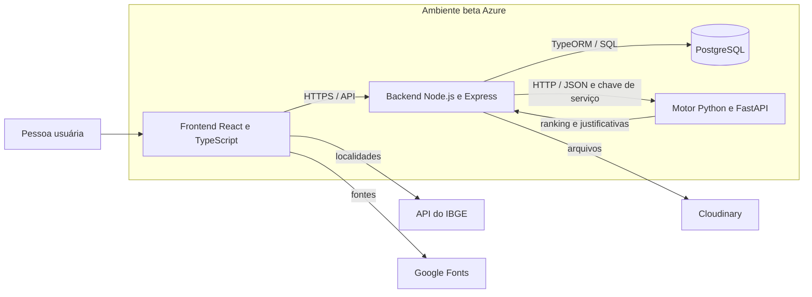

# Juntaí! Frontend

**Juntaí!** é uma plataforma de matchmaking que aproxima startups, investidores anjo e mentores do ecossistema de inovação do Nordeste.

O projeto integra o Projeto Integrador do 5º período de Análise e Desenvolvimento de Sistemas da Faculdade Senac Pernambuco. Este repositório contém a interface web: as telas que permitem apresentar perfis, descobrir oportunidades e iniciar conversas. A API e o motor de recomendações são aplicações separadas.

**Demonstração beta na Azure:** [acessar a plataforma](https://delightful-beach-0c45f1a10.4.azurestaticapps.net/). Os perfis de demonstração são fictícios.

---

## 📌 Sobre o projeto

Encontrar parceiros alinhados pode exigir pesquisa em diferentes canais, troca de apresentações e comparação manual de informações. O Juntaí! reúne perfis e preferências para facilitar essa descoberta. A compatibilidade apresentada serve como apoio à triagem: a decisão de conversar, investir ou oferecer mentoria continua com as pessoas envolvidas.

O frontend organiza a jornada de cadastro e os recursos de navegação, descoberta, mensagens e administração. Ele valida entradas e apresenta os retornos da API; autenticação, autorização, persistência e regras de negócio são responsabilidade do backend.

### Repositórios da plataforma

- **Frontend:** https://github.com/renatodelgado/Juntai-Frontend
- **Backend usado no beta:** https://github.com/renatodelgado/Juntai-Backend
- **Motor de matchmaking usado no beta:** https://github.com/renatodelgado/Juntai-matchmaking-IA
- Repositórios de origem: [backend de Clara Melo](https://github.com/ClaraMelo72/Juntai-Backend) e [motor de Vinícius](https://github.com/vicent777/Juntai-matchmaking-IA). As cópias usadas no beta podem estar em versões diferentes das originais.

---

## 🎯 Objetivo

Oferecer uma experiência web que permita:

- Cadastrar e apresentar startups, investidores e mentores;
- Explorar perfis e visualizar sugestões de conexão;
- Registrar interesse e acompanhar oportunidades;
- Trocar mensagens e organizar reuniões entre participantes;
- Apoiar a moderação e o acompanhamento administrativo;
- Apresentar o uso de dados e os limites do serviço de forma clara.

---

## 👥 Atores

### Startup / empreendedor

Apresenta o negócio, seu estágio, segmento, mercado, necessidades e materiais. Após a análise do cadastro, pode consultar interessados, conversar e acompanhar reuniões.

### Investidor anjo / mentor

Informa sua experiência e preferências, explora startups e consulta recomendações. Pode demonstrar interesse e iniciar conversas conforme as regras da plataforma.

### Administrador

Acompanha cadastros, perfis, denúncias, reuniões e registros administrativos. O acesso às áreas administrativas exige conta e permissões correspondentes.

---

## 🚀 Funcionalidades

- **Cadastro:** jornadas específicas para startup e investidor/mentor, com revisão dos dados e opção de salvar rascunho no navegador.
- **Conta e perfil:** login, recuperação de senha, visualização e edição dos dados enviados ao servidor.
- **Descoberta:** listagem de startups, busca, filtros e consulta de perfis disponíveis.
- **Recomendações:** apresentação de oportunidades ordenadas pela estratégia configurada no backend, com informações de compatibilidade quando disponíveis.
- **Conexão:** registro de interesse, acompanhamento de interessados, mensagens e agendamento de reuniões.
- **Feedback e moderação:** avaliação após interações, denúncias e acompanhamento administrativo, conforme o perfil e o estado da conta.
- **Privacidade:** acesso aos termos de uso e à política de privacidade da versão de testes.

Contas recém-criadas passam por análise. Algumas áreas exigem perfil aprovado. Favoritos e parte do estado da descoberta são locais ao navegador e não são sincronizados entre dispositivos. Uploads e recuperação de senha dependem de serviços configurados no backend.

---

## 🏗️ Arquitetura



O navegador acessa o frontend e chama a API. O backend consulta o banco e, quando necessário, envia uma projeção dos perfis ao motor. O motor devolve uma lista ordenada à API, que a apresenta à interface. O frontend não acessa diretamente o PostgreSQL ou o serviço de matchmaking.

Os dados de perfis, mensagens e reuniões são transacionais; exposições e interações de descoberta são comportamentais. As recomendações são solicitadas sob demanda, enquanto o backend verifica periodicamente reuniões elegíveis à conclusão. O diagrama também permanece versionado em [`docs/arquitetura.md`](docs/arquitetura.md).

---

## 📂 Estrutura do projeto

```text
Juntai-Frontend/
├── public/                 # Arquivos públicos e configuração da hospedagem
├── src/
│   ├── app/                # Aplicação e rotas
│   ├── features/           # Funcionalidades por domínio
│   │   ├── auth/           # Sessão, autenticação e integração de cadastro
│   │   ├── startup-onboarding/ e investor-onboarding/
│   │   ├── explore-startups/, investor-matches/ e startup-matches/
│   │   ├── messages/, meetings/, feedback/ e moderation/
│   │   └── admin/          # Área administrativa
│   ├── shared/             # Componentes, estilos, configuração e serviços
│   └── main.tsx            # Entrada da aplicação
├── tests/                  # Testes automatizados e de navegador
├── docs/                   # Documentação complementar
├── .env.example            # Exemplo da URL da API
├── package.json            # Scripts e dependências
├── package-lock.json       # Versões resolvidas pelo npm
└── vite.config.ts          # Configuração do Vite
```

---

## 🛠️ Stack

| Tecnologia            | Uso no projeto                                        |
| --------------------- | ----------------------------------------------------- |
| React 19 e TypeScript | Componentes, estado e tipagem da interface            |
| Vite                  | Desenvolvimento e geração do build                    |
| React Router          | Navegação, rotas protegidas e carregamento de páginas |
| styled-components     | Estilização dos componentes                           |
| Zod                   | Validação e leitura de dados e contratos              |
| idb-keyval            | Armazenamento de rascunhos no navegador               |
| Playwright            | Testes de fluxos no navegador                         |
| ESLint e Prettier     | Verificação de código e formatação                    |

As versões declaradas e efetivamente instaladas estão em `package.json` e `package-lock.json`. O projeto exige Node.js **22.12 ou superior**.

---

## ⚙️ Instalação

### Pré-requisitos

- Git, Node.js 22.12 ou superior e npm;
- Backend e banco compatível para os fluxos que utilizam a API;
- Motor Python em execução para recomendações locais;
- Microsoft Edge para os testes de navegador configurados no projeto.

### Clonar e instalar

```bash
git clone https://github.com/renatodelgado/Juntai-Frontend.git
cd Juntai-Frontend
npm ci
```

### Configurar o endereço da API

Copie `.env.example` para `.env.local`:

```bash
cp .env.example .env.local
```

No PowerShell:

```powershell
Copy-Item .env.example .env.local
```

| Variável       | Finalidade               | Exemplo local           |
| -------------- | ------------------------ | ----------------------- |
| `VITE_API_URL` | Origem da API do backend | `http://localhost:3333` |

Altere a URL se o backend utilizar outra porta. Variáveis `VITE_*` são incorporadas ao código disponibilizado ao navegador: nunca coloque nelas senhas ou chaves de serviço.

### Iniciar em desenvolvimento

```bash
npm run dev
```

Abra o endereço informado pelo Vite, normalmente `http://localhost:5173`. A interface abre sem a API, mas os fluxos integrados precisam do backend. Para executar a plataforma completa, configure também o PostgreSQL e o motor conforme os respectivos READMEs.

**Limite atual do ambiente limpo:** o repositório do backend não contém uma migration inicial completa para criar o banco a partir de um PostgreSQL vazio. É necessário preparar um esquema de teste compatível antes de validar cadastro e demais fluxos persistidos. Não utilize dados pessoais reais como massa de teste.

---

## 🔐 Autenticação e dados

O login é realizado pela API. A interface mantém a sessão na aba e envia o token nas chamadas protegidas; o backend verifica a identidade e as permissões. Rotas de startup, investidor e administração têm controles próprios, e algumas exigem aprovação do perfil.

Os rascunhos salvos durante o cadastro ficam no navegador. Dados de perfil enviados, mensagens e reuniões são tratados pela API. Fotos e apresentações podem ser enviadas ao armazenamento de mídia configurado no backend. A seleção de localidades utiliza a API pública do IBGE.

Os termos e a política de privacidade são provisórios. Os aceites ainda não são registrados no servidor; canal para titulares, exclusão integral e regras de retenção permanecem pendentes. A existência das telas não comprova, por si só, conformidade integral com a LGPD.

---

## 🧪 Testes e validação

| Comando                         | Finalidade                                                               |
| ------------------------------- | ------------------------------------------------------------------------ |
| `npm run typecheck`             | Verifica os tipos TypeScript                                             |
| `npm run lint`                  | Executa o ESLint                                                         |
| `npm run format:check`          | Verifica a formatação                                                    |
| `npm run check`                 | Executa as três verificações anteriores                                  |
| `npm test`                      | Testes de recomendações e reuniões                                       |
| `npm run test:browser`          | Conjunto de testes de navegador com respostas simuladas                  |
| `npm run test:meetings:browser` | Teste de reuniões no navegador, com build prévio pelo script             |
| `npm run test:recovery:browser` | Teste de recuperação de senha no navegador, com build prévio pelo script |
| `npm run test:money:browser`    | Teste de campos monetários no navegador                                  |
| `npm run build`                 | Verifica tipos e gera os arquivos de produção em `dist/`                 |
| `npm run preview`               | Serve localmente um build já gerado                                      |

Os testes simulados não substituem uma homologação ponta a ponta com API, banco e serviços externos. No Windows, diferenças de fim de linha podem afetar o Prettier; o workflow Linux do repositório também executa as verificações.

---

## ⚡ Automação e regras ECA

**Interesse em startup:** quando um investidor confirma interesse, o backend verifica se os dois perfis estão ativos e aprovados e registra o evento se ele ainda não existir. A regra está no backend em `src/modules/startups/services/StartupInterestService.ts`; `tests/matchmaking.test.cjs` cobre a idempotência.

**Recomendação:** quando o backend solicita sugestões, o motor compara os atributos disponíveis e devolve uma ordenação com afinidade e cobertura. A regra está em `app/rules.py` do motor e é exercitada por `tests/test_rules.py`. O frontend apresenta o resultado; não calcula uma garantia de investimento.

---

## ☁️ Deploy e versão

O beta é publicado na Azure Static Web Apps a partir do workflow `.github/workflows/azure-beta.yml`. A configuração fornece a URL da API no momento do build e encaminha rotas da aplicação para `index.html`. O backend e o motor são serviços separados na Azure.

```bash
npm run build
```

O build é gerado em `dist/`. A tag `v1.0-high-tech` identifica a versão preparada para a entrega de High Tech; alterações posteriores na branch principal não mudam o conteúdo dessa tag. A disponibilidade da demonstração depende da infraestrutura e dos serviços externos.

---

## 📋 Limitações e próximos passos

- A plataforma está em beta e seus resultados ainda não demonstram redução medida do tempo de triagem.
- A estratégia padrão usa regras; o modelo supervisionado é experimental e foi treinado com interações sintéticas.
- Uma sugestão não comprova adequação financeira, interesse ou realização de investimento.
- A preparação de um banco vazio, a homologação de segurança, a continuidade e os fluxos completos de privacidade precisam ser concluídos.
- Serviços externos, rede e escala zero podem afetar disponibilidade e tempo de resposta.

---

## 🎓 Projeto Integrador e equipe

- **Curso:** Análise e Desenvolvimento de Sistemas — 5º período
- **Instituição:** Faculdade Senac Pernambuco
- **Projeto:** Startups e Economia Criativa — Juntaí!

**Integrantes:** João Victor Rodrigues Basante, João Vitor Malveira da Silva, Maria Clara de Melo, Renato Trancoso Branco Delgado, Thayana Anália dos Santos Lira e Vinícius Henrique Silva Nascimento.

## 🤖 Uso de inteligência artificial

- **Identidade visual:** ChatGPT auxiliou no brainstorming de tipografia e cores; o logo final foi feito por uma designer profissional.
- **Prototipagem e frontend:** ChatGPT e Codex apoiaram a jornada de usuário, posteriormente modificada pela equipe. Codex e UXPilot auxiliaram na prototipagem a partir de definições da equipe; o Codex também foi utilizado de maneira supervisionada na programação, conforme as prioridades do cronograma.
- **Backend e matchmaking:** Claude foi a ferramenta mais utilizada como apoio à programação, além do ChatGPT. Gemini auxiliou em verificações de segurança.
- **Documentação:** Codex e Claude auxiliaram na produção e revisão dos textos.

As decisões, a compreensão do código e a validação dos resultados são responsabilidade da equipe.

## 📌 Status e licença

🚧 Projeto acadêmico em desenvolvimento e disponível em beta. A licença de distribuição ainda não foi definida pelo grupo.
